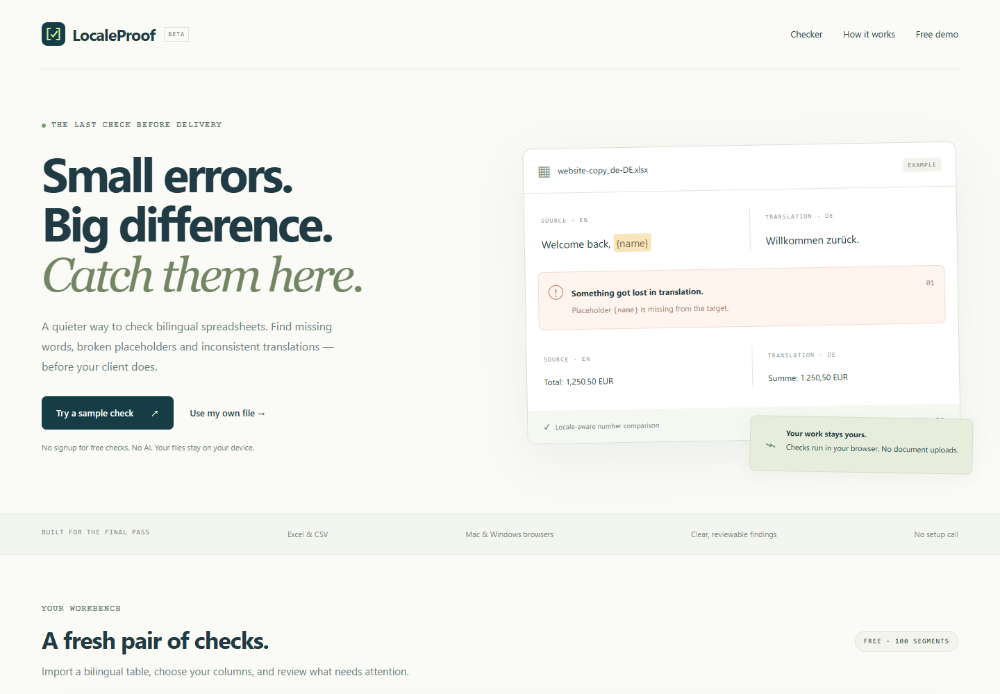

# LocaleProof — bilingual spreadsheet QA demo

**[Try the live demo](https://zhang21901.github.io/localeproof/)** · [Guide](https://zhang21901.github.io/localeproof/guide.html) · [Feedback](https://github.com/Zhang21901/localeproof/issues)

Catch missing translations, placeholder differences, number changes and inconsistent target text in bilingual XLSX, CSV and TSV files. Runs locally in your browser; no document uploads, AI calls or signup.

## Try it
1. Open the demo and click **Try a sample check**.
2. Review the ten sample segments and their findings.
3. Mark intentional differences ignored, add notes and export CSV.
4. Try your own table: map source/target columns and select the right number conventions.

## Public demo limits
One file and 100 non-empty segments per check. Input ≤10 MB. English, German and French number formats. Text can be in other languages, but this is not linguistic review. ICU syntax, printf argument semantics and nested tags need dedicated validation. Review decisions stay in memory; export before closing. Tested in Chromium; native Safari and Firefox checks remain pending.

The public demo has no checkout, account, Pro backend, tracking or subscription. Pro development is maintained separately and is not sold through this demonstration.

## Report useful feedback
Open an issue with a synthetic two-column example, browser/version, expected finding and actual result. Never upload confidential client files. Which repetitive final-pass check would save you the most time?

## Local preview
Serve this directory using a static HTTP server. Root and subdirectory hosting are supported. No build step is needed.

## License and third-party notices
Copyright 2026 Zhang21901. All rights reserved unless noted. This source is published for inspection and hosting this demonstration; no separate redistribution license is granted. SheetJS CE 0.20.3 is included under Apache-2.0; see [its license](vendor/SHEETJS-LICENSE.txt).
